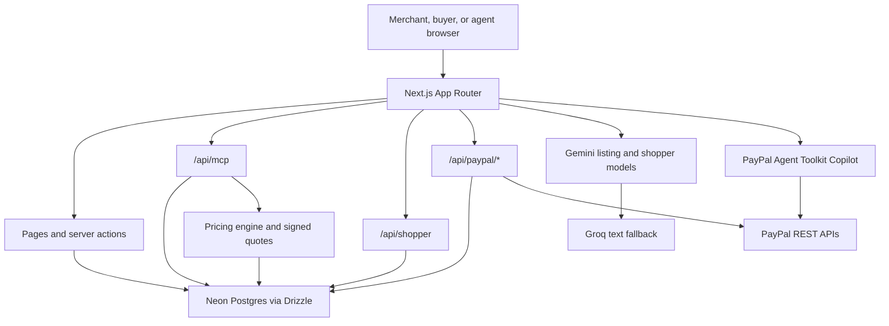

# AgentShelf: make any small shop sellable to AI agents, paid safely with PayPal.

[Live demo](https://agentshelf-jade.vercel.app) · [Judge tour](https://agentshelf-jade.vercel.app/tour) · [Security results](https://agentshelf-jade.vercel.app/security) · Video: `VIDEO_URL_TBD`

## The problem

AI agents are starting to shop for people.
PayPal's agent-commerce programs serve large merchants.
Small makers (one person, a phone, a few products) are invisible to agents and cannot safely let a bot negotiate or pay.

## What it does

### Maya, the merchant

- Captures product photos on her phone.
- Reviews an AI-generated listing and moderation result.
- Publishes to the PayPal Catalog and her AgentShelf storefront.
- Gets an MCP endpoint that agents can use to discover and buy her work.

### Sam, the buyer

- Creates an Agent Pass by approving a reusable PayPal Vault payment token.
- Sets a total budget, per-order maximum, expiry, and allowed categories.
- Lets an agent pay within those limits without another checkout click.
- Can revoke the pass; orders over its step-up threshold return to a human-approved PayPal link.

### The agent

- Uses the hosted Shopper Agent or any compatible MCP client.
- Searches published items and negotiates through the shop's deterministic pricing engine.
- Receives an HMAC-signed quote with a 15-minute expiry.
- Checks out through PayPal Orders v2 and can check order status.

## Features mapped to judging criteria

| Criterion | What we built | Where in code |
| --- | --- | --- |
| Technical Implementation | Server-rendered App Router pages, Drizzle/Postgres persistence, MCP tools, signed quotes, and verified PayPal webhooks. | `app/`, `lib/db/`, `lib/mcp/tools.ts`, `lib/commerce/quotes.ts`, `app/api/paypal/webhooks/route.ts` |
| Design | Mobile-first product capture, a split-screen shopper journey, merchant dashboard, and storefront. | `components/merchant/capture-flow.tsx`, `components/shopper/shopper-experience.tsx`, `app/merchant/(protected)/page.tsx`, `app/s/[slug]/page.tsx` |
| Potential Impact | Photo-to-listing workflow, storefront availability, and agent-readable product discovery for independent makers. | `app/api/listings/draft/route.ts`, `lib/agents/lister.ts`, `app/s/[slug]/page.tsx`, `lib/mcp/tools.ts` |
| Innovation | Bayesian repeated-game pricing, server-verified mandates, and two checkout paths. | `lib/commerce/pricing-brain.ts`, `lib/passes/budget.ts`, `lib/commerce/checkout.ts` |
| Presentation | Hosted Shopper Agent, judge tour, generated Open Graph image, and live security results. | `app/shopper/page.tsx`, `app/tour/page.tsx`, `app/opengraph-image.tsx`, `app/security/page.tsx` |
| Best Use of PayPal + AI | Gemini-assisted listing and shopper language around PayPal Vault, Orders, and Payouts. | `lib/agents/lister.ts`, `lib/commerce/checkout.ts`, `lib/paypal/` |
| Best Use of Agentic Commerce | MCP search-to-checkout contract with optional mandate-based automatic payment. | `app/api/mcp/route.ts`, `lib/mcp/tools.ts`, `lib/commerce/checkout.ts` |
| AG Grid prize | Community AG Grid powers merchant product, negotiation, and order tables; product edits validate and save inline. | `components/merchant/products-grid.tsx`, `components/merchant/negotiations-grid.tsx`, `components/merchant/orders-grid.tsx` |

## PayPal APIs used

| API | Endpoint or action | Used for | File |
| --- | --- | --- | --- |
| OAuth 2.0 | `POST /v1/oauth2/token` | App-only access token cached in server memory. | `lib/paypal/client.ts` |
| Orders v2 | `POST /v2/checkout/orders` | Flow A order with the merchant as payee; Flow B order using a vaulted payment token. | `lib/paypal/orders.ts` |
| Orders v2 | `GET /v2/checkout/orders/{id}` | Refresh order state and parse the completed capture. | `lib/paypal/orders.ts` |
| Orders v2 | `POST /v2/checkout/orders/{id}/capture` | Capture an approved Flow A order. | `lib/paypal/orders.ts` |
| Vault v3 | `POST /v3/vault/setup-tokens` | Create the buyer-approved setup request. | `lib/paypal/vault.ts` |
| Vault v3 | `POST /v3/vault/payment-tokens` | Exchange the approved setup token for a reusable payment token. | `lib/paypal/vault.ts` |
| Vault v3 | `DELETE /v3/vault/payment-tokens/{id}` | Request deletion when a buyer revokes an Agent Pass. | `lib/paypal/vault.ts` |
| Payouts v1 | `POST /v1/payments/payouts` | Release Flow B proceeds to the merchant. | `lib/paypal/payouts.ts` |
| Webhooks | `POST /v1/notifications/verify-webhook-signature`; handles `CHECKOUT.ORDER.APPROVED`, `PAYMENT.CAPTURE.COMPLETED`, `PAYMENT.CAPTURE.DENIED`, `PAYMENT.CAPTURE.REFUNDED` | Verify signatures, deduplicate events, and reconcile order state. | `lib/paypal/webhooks.ts`, `app/api/paypal/webhooks/route.ts` |
| Catalog Products v1 | `POST /v1/catalogs/products`, `GET /v1/catalogs/products/{id}` | Create and look up the merchant's catalog listing. | `lib/paypal/catalog.ts` |
| PayPal Agent Toolkit | Shipment tracking, order lookup, transaction listing, and refund actions | Merchant Copilot actions through the official toolkit. Flow A tracking/refunds are refused by PayPal because the platform is not the payee. | `lib/paypal/agent-toolkit.ts`, `lib/agents/toolkit-bridge.ts`, `lib/merchant/order-operations.ts` |

The Agent Toolkit can return PayPal errors as strings or error-shaped results. `lib/agents/toolkit-bridge.ts` converts those results to failures instead of reporting false success.

## The two payment flows

### Flow A: PayPal approval link

1. The app reserves stock and consumes a signed quote.
2. PayPal Orders v2 creates an order with the shop's PayPal account as payee.
3. The buyer approves at PayPal; AgentShelf captures idempotently and commits stock once.
4. The receipt records the capture, PayPal fee, net amount, and available shipping details.

### Flow B: Agent Pass Vault

1. The buyer approves a reusable PayPal Vault token and sets a spending mandate.
2. A transaction atomically reserves the pass budget and product stock before a vaulted Orders v2 capture.
3. AgentShelf pays the merchant's net proceeds through a PayPal Payout.
4. A purchase over the pass's step-up threshold falls back to Flow A and asks the human to approve.

Flow B is a demo escrow pattern: AgentShelf captures to the platform and then sends a payout. A production version would use PayPal Multiparty / Commerce Platform onboarding so the platform never holds merchant funds.

Pass budget reservation is atomic in the database. Repeated checkout with the same quote reuses the existing order, and capture completion uses an idempotent state transition to avoid double stock commits.

PayPal sandbox verification found that Flow A tracking and refunds are refused because the platform is not the payee. The app keeps locally entered tracking and directs the merchant to add it in PayPal; direct-payment refunds are unavailable in AgentShelf.

## Pricing brain: the team's research

The pricing model maps to *Bayesian, Utility-Maximizing Tit-for-Tat Repeated-Game Pricing* (Shakeel, Dadabhoy, Siddiqui, Soomar, 2026).

- Updates the probability that a buyer is price-sensitive from observed negotiation moves.
- Uses the `COOPERATE` and `DEFECT_RECOVERY` states described by the paper's Algorithms 2 and 3.
- Evaluates `{0.97, 1.05} × list` candidates while cooperating and `{0.85, 0.90} × list` candidates while recovering.
- Selects the candidate with maximum expected utility using acceptance probability and estimated unit cost.
- Applies Algorithm 3's tolerance-breach streak and final-offer behavior.
- Adds marketplace rules that clamp offers to the merchant's private `[floor, list]` range and never raise the shop's offer within a negotiation.
- The LLM parses buyer intent and writes reply text; it does not choose a price. Floor and cost are not included in its prompt context.

The paper reports a 127.1% profit result in the paper's calibrated simulation on Olist data. This is not a measured AgentShelf result.

## Security

See the [security page](https://agentshelf-jade.vercel.app/security) for the threat model and latest recorded production run. The table below is generated from `public/security/attacks-latest.json` (run timestamp: 2026-11-11 20:30 UTC; target: production demo). It contains the 12 recorded attack scenarios and the scoped cleanup check.

| ID | Attack or check | Result |
| --- | --- | --- |
| S1 | Buyer prompt injection | PASS |
| S3a | Unknown quote | PASS |
| S3b | Expired signed quote | PASS |
| S3c | Tampered signed quote | PASS |
| S4 | Duplicate checkout | PASS |
| S5a | Unknown Agent Pass token | PASS |
| S5b | Revoked Agent Pass | PASS |
| S5c | Agent Pass budget | PASS |
| S6 | Forged PayPal webhook | PASS |
| S8 | Cross-merchant order access | PASS |
| S11 | MCP negotiation burst | PASS |
| S13 | Private pricing output scan | PASS |
| CLEANUP | Scoped test-data cleanup | PASS |

Run the full attack suite only against a disposable demo environment with the required confirmation flag:

```sh
pnpm attacks -- --confirm
pnpm test
```

Key defenses include:

- HMAC-signed, expiring quotes; checkout rechecks the signature and product status.
- The pricing engine is the only component that selects negotiation prices.
- Agent Pass credentials are stored as hashes, are revocable, and reserve budget atomically.
- Webhook signatures are verified and PayPal order state is fetched again before applying events.
- Product, order, and merchant actions are scoped to the authenticated merchant.
- Database-backed rate limits cover expensive endpoints.
- Image uploads use magic-byte detection and image re-encoding to strip metadata.
- Product drafts pass model and deterministic moderation before publication.
- Security headers include a Content Security Policy in Report-Only mode. It remains report-only while PayPal, Next.js, AG Grid, and chart runtime requirements are evaluated.
- `pnpm secrets:scan` scans the repository for likely exposed credentials.

## Architecture



Detailed system and flow diagrams are in [Architecture](docs/ARCHITECTURE.md). The implementation mapping for the research model is in [Pricing](docs/PRICING.md); the callable contract is in [MCP](docs/MCP.md); the control/test map is in [Security](docs/SECURITY.md).

### Stack

Versions below come from `package.json` and `pnpm-lock.yaml`.

- Next.js 16.4.5, React 19.3.0, TypeScript 5, Tailwind CSS 4.
- Drizzle ORM 0.45.x with Neon-hosted PostgreSQL.
- Vercel AI SDK 7.x, Google AI SDK 4.x, Groq SDK 4.x.
- AG Grid Community 36.x and AG Charts Community 14.x.
- PayPal Agent Toolkit 1.11.0, Zod 4.x, Vitest 5.x.

## Try it

### For judges

Start at the [judge tour](https://agentshelf-jade.vercel.app/tour). The hosted site uses PayPal sandbox only; it does not move real money. Sandbox buyer instructions are provided separately in the Devpost testing instructions and are not repeated here.

### Connect an MCP client

The public Streamable HTTP MCP endpoint is:

```text
https://agentshelf-jade.vercel.app/api/mcp
```

Claude Desktop can connect through `mcp-remote` using this `claude_desktop_config.json` shape:

```json
{
  "mcpServers": {
    "agentshelf": {
      "command": "npx",
      "args": ["-y", "mcp-remote", "https://agentshelf-jade.vercel.app/api/mcp"]
    }
  }
}
```

### MCP tools

| Tool | Purpose |
| --- | --- |
| `search_products` | Search published, available products by text, category, and optional list-price ceiling. |
| `get_product` | Return public listing details, images, availability, and price. |
| `request_offer` | Start a 1–10 item negotiation and return an opening offer plus signed quote. |
| `negotiate` | Send a buyer message or counter and receive the pricing engine's next decision. |
| `checkout` | Turn a valid quote into PayPal approval or eligible Agent Pass checkout. |
| `order_status` | Return order status and public tracking without buyer email or address. |
| `pass_status` | Return an authenticated Agent Pass's limits and remaining budget. |

Calls are limited to 120 per IP per minute. `negotiate` is additionally limited to 20 per IP per minute, and `request_offer` to 30 per IP per minute. Product discovery does not require authentication. Attach an optional Agent Pass Bearer for mandate-aware purchase actions; `pass_status` requires one.

### Run locally

Requirements: Node.js supported by the pinned Next.js release and pnpm 11.19.0.

```sh
pnpm i
Copy-Item .env.example .env.local
# Set the local database URL and required service credentials in .env.local.
pnpm db:push
pnpm db:seed -- --confirm
pnpm dev
```

| Environment variable | Purpose |
| --- | --- |
| `DATABASE_URL` | PostgreSQL connection string. |
| `APP_URL` | Public base URL used to build links and callback URLs. |
| `SESSION_SECRET` | Merchant session signing secret. |
| `QUOTE_SIGNING_SECRET` | Quote HMAC signing secret. |
| `PAYPAL_ENV` | Selects PayPal sandbox or live API host. |
| `PAYPAL_CLIENT_ID` | PayPal REST application client identifier. |
| PAYPAL\_CLIENT\_SECRET | PayPal REST application client secret. |
| `PAYPAL_WEBHOOK_ID` | Registered PayPal webhook ID for signature verification. |
| `AGENTSHELF_PASS_TOKEN` | Optional local MCP smoke-test bearer token. |
| `SHOPPER_SMOKE_URL` | Base URL used by the Shopper Agent smoke script. |
| `GOOGLE_GENERATIVE_AI_API_KEY` | Google Gemini API credential. |
| `GROQ_API_KEY` | Groq text model API credential. |
| `GEMINI_MODEL` | Optional Gemini model override. |
| `GROQ_MODEL` | Optional Groq model override. |
| `PAYPAL_MERCHANT1_EMAIL` | Optional PayPal email for the Maya demo shop. |
| `PAYPAL_MERCHANT2_EMAIL` | Optional PayPal email for the Lahore Threads demo shop. |
| `DEMO_MODE` | Enables local demo-specific behavior. |
| `NEXT_PUBLIC_JUDGE_MODE` | Enables the public judge-mode banner. |
| `ATTACKS_URL` | Target URL used by the attack-suite script. |

### Demo data

The seeded demo shops are Maya Clay and Lahore Threads. Dashboard history is generated demo data: roughly 40 orders are marked `is_demo` and are built using the pricing engine; PayPal actions are disabled on those rows. A live sandbox checkout creates a real PayPal sandbox transaction.

## Known limitations

- The hosted demo is configured for PayPal sandbox. The README does not provide sandbox buyer credentials.
- Flow B is a demo escrow pattern and should move to PayPal Multiparty / Commerce Platform onboarding before production use.
- The paper's Algorithm 1 behavioral classification tree is not implemented. Buyers use the paper's 0.5 prior unless a trusted segment is supplied; the current buyer flow starts at 0.5.
- The Content Security Policy is Report-Only.
- Free-tier model failures fall back to deterministic text templates.
- `pnpm audit --prod` reports advisories through `@paypal/agent-toolkit`. Most are in its unused LangChain entry; the remaining advisories are in its pinned `ai@4` / `mathjs` dependencies. They are not overridden to avoid breaking the toolkit.

## Credits

### Team

Muhammad Yousuf · Ahsan Ahmed Siddiqui · Huzaifa Soomar · Shamoeel · Ibraheem Qadeer · Zain Dadabhoy

### Research

Bayesian, Utility-Maximizing Tit-for-Tat Repeated-Game Pricing — Shakeel, Dadabhoy, Siddiqui, and Soomar (2026).

### Product photography

Credits are maintained in `public/seed/credits.json`.

| Product | Photographer | Source | License |
| --- | --- | --- | --- |
| Hand-glazed speckled mug | Andreas Haslinger | [Unsplash](https://unsplash.com/photos/speckled-ceramic-mug-on-marble-qX7tgapreJU) | Unsplash License |
| Ceramic pour-over dripper | ly | [Pexels](https://www.pexels.com/photo/a-ceramic-pour-over-coffee-dripper-with-a-filter-8214439/) | Pexels License |
| Small bud vase set (3) | Tamara Harhai | [Unsplash](https://unsplash.com/photos/-cfd9px-GV8) | Unsplash License |
| Stoneware serving bowl | Susan Wilkinson | [Unsplash](https://unsplash.com/photos/OXOz4wP7QhY) | Unsplash License |
| Incense holder | Cosmin Ursea | [Unsplash](https://unsplash.com/photos/a-smokestack-sitting-in-a-bowl-on-a-table-k0bv_oE34DQ) | Unsplash License |
| Hand-embroidered cotton table runner | Sena | [Pexels](https://www.pexels.com/photo/a-cup-of-coffee-on-the-table-14181255/) | Pexels License |
| Embroidered canvas tote | Sara mazin | [Pexels](https://www.pexels.com/photo/black-bag-with-roses-20206390/) | Pexels License |
| Mirror-work cushion cover | Corryne Wooten | [Unsplash](https://unsplash.com/photos/ImXQXFYSjb4) | Unsplash License |
| Embroidered fabric bookmark set | Olga Kalinina | [Pexels](https://www.pexels.com/photo/close-up-shot-of-a-bookmark-8715442/) | Pexels License |

### License

This project is licensed under the MIT License. See [`LICENSE`](LICENSE).

### Source

[GitHub repository](https://github.com/MuhamadYousuf/agentshelf)
