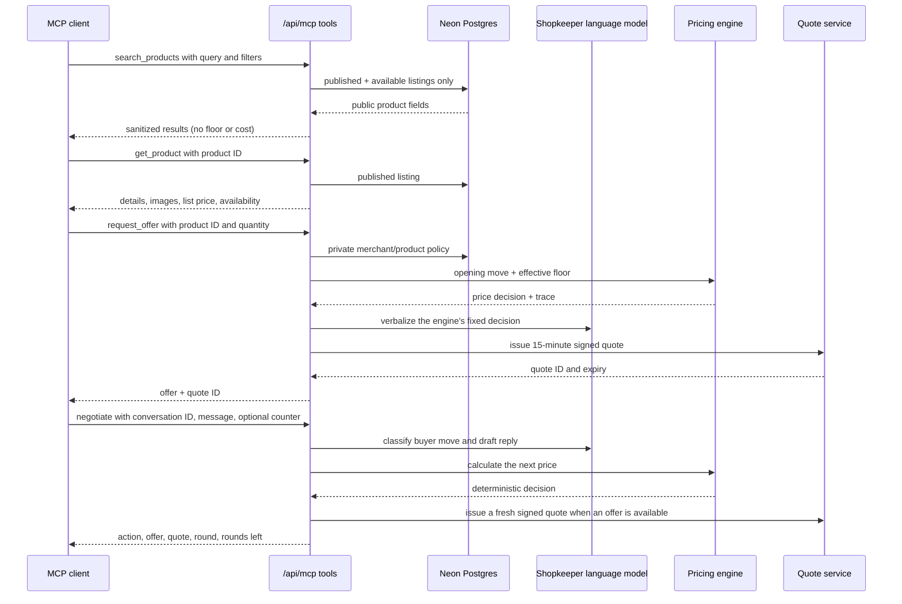
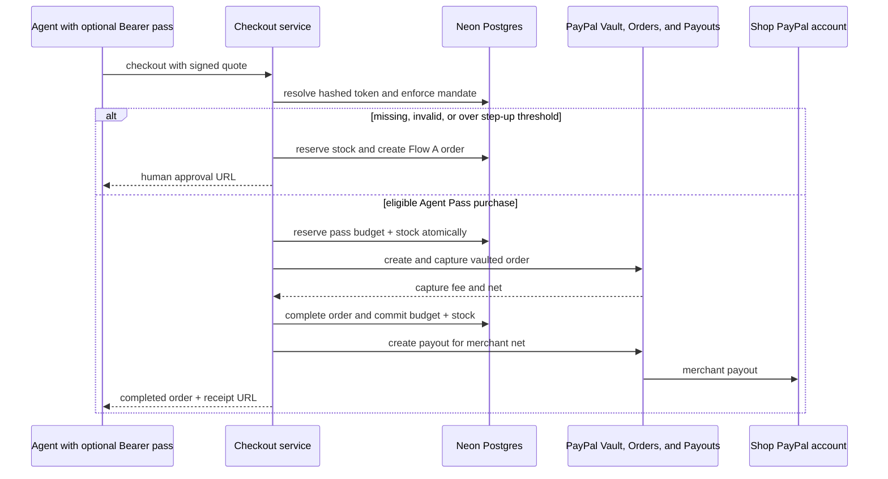

# AgentShelf architecture

AgentShelf is a Next.js 16 App Router application backed by Neon Postgres. Drizzle owns database access; PayPal REST calls live in server-only modules; MCP and the hosted Shopper Agent call the same commerce services used by the storefront. Public product and agent responses are built from an explicit allowlist.

## Product discovery and negotiation



The LLM classifies and verbalizes buyer intent; the pricing engine is the only component that selects a price. Quotes sign the product, merchant, quantity, unit and total price, optional Agent Pass, and expiry. Checkout verifies the HMAC and rechecks expiry, use state, and publication status.

## Checkout: Flow A and Flow B

```mermaid
sequenceDiagram
  participant B as Buyer or agent
  participant C as Checkout service
  participant DB as Neon Postgres
  participant PP as PayPal
  participant S as Shop PayPal account
  B->>C: checkout with quote ID
  C->>DB: expire stale reservations; look up existing order
  C->>DB: verify quote; atomically reserve stock and consume quote
  C->>PP: create Orders v2 order (Flow A payee = shop)
  PP-->>C: order ID + approval URL
  C-->>B: approval URL
  B->>PP: approve payment
  PP->>C: return redirect or signed webhook
  C->>PP: fetch/capture order idempotently
  PP-->>C: completed capture, fee, net, payer, shipping
  C->>DB: complete once; decrement stock and reservation
  PP->>S: settle Flow A funds directly to shop
```

Flow A is the human-approval path and the default for MCP clients without a valid Agent Pass. The order uses the merchant's PayPal email as the payee. A return request and an approved-order webhook can both trigger capture; the order state transition commits inventory and records payment once.

For Flow B, checkout first validates the pass status, mandate expiry, category, per-order maximum, step-up threshold, and available total budget. A transaction reserves both the pass budget and stock before the platform-payee Vault order is captured. AgentShelf then requests a PayPal Payout to the merchant. Amounts above the mandate's step-up threshold use Flow A instead. Flow B is a demo escrow arrangement; production should use PayPal Multiparty / Commerce Platform onboarding.



## Webhook and reservation lifecycle

PayPal sends events to `POST /api/paypal/webhooks`. The route checks that a webhook ID is configured, applies a database-backed IP limit, parses the raw event, and asks PayPal to verify its signature. It inserts the PayPal event ID into `events.external_id`; a unique constraint makes duplicates return successfully without repeating work. For order approval and capture events, the handler fetches the current order from PayPal before changing local state. A capture completes an order and inventory in one transaction. A refund updates a completed order to refunded. Failed, cancelled, and stale approvals release reservations. Since the app has no scheduled job, stale reservations are expired opportunistically at checkout and webhook entry (30 minutes after creation).

```mermaid
sequenceDiagram
  participant PP as PayPal
  participant W as Webhook route
  participant DB as Neon Postgres
  W->>DB: expire reservations older than 30 minutes
  PP->>W: signed event and raw body
  W->>PP: verify webhook signature
  PP-->>W: SUCCESS or failure
  alt signature invalid or webhook missing
    W-->>PP: 400 or 503; no order mutation
  else valid signature
    W->>DB: insert event ID with unique external ID
    alt event already seen
      W-->>PP: 200 duplicate
    else new event
      W->>PP: fetch current PayPal order
      alt order approved, no capture yet
        W->>PP: capture once with stable request ID
      else capture completed, denied, or refunded
        W->>DB: apply only the status confirmed by fetched PayPal order
      end
      W->>DB: commit stock once or release reservation
      W-->>PP: 200 received
    end
  end
```

## Hosted Shopper Agent

The hosted Shopper Agent at `/shopper` streams progress over `POST /api/shopper`. It uses the same MCP tool implementations and quote/checkout services, but adds a buyer budget, product selection, a run lock, and request limits. Product copy is marked as untrusted input; the agent validates its final chosen item and price against the buyer's budget before checkout. The shopper requires a buyer budget and returns an approval URL when the order uses Flow A.

## Merchant Copilot

The merchant Copilot is scoped from the authenticated merchant session before it loads orders or invokes a tool. Read-only order lookup, dashboard summaries, and grid views use merchant-owned rows. Mutating actions validate the target order under that same merchant ID. Refunds require explicit confirmation. The PayPal Agent Toolkit bridge treats serialized error-shaped results as failures, strips token/secret/authorization fields from successful values, and avoids reporting false success. PayPal may refuse Flow A tracking or refunds because the platform is not the payee; local tracking remains available.

```mermaid
sequenceDiagram
  participant M as Merchant
  participant UI as Copilot panel
  participant API as Merchant Copilot route
  participant ACT as Merchant order action
  participant DB as Neon Postgres
  participant AI as Tool-calling model
  participant PP as PayPal Agent Toolkit
  M->>UI: Ask about orders, sales, or an action
  UI->>API: POST message with session cookie
  API->>DB: derive merchant scope from session; apply limit
  API->>AI: run Copilot with scoped tools
  AI->>API: request a typed tool
  API->>DB: query or validate this merchant's data only
  DB-->>API: scoped rows or action state
  opt PayPal lookup or tracking sync
    API->>PP: run supported merchant action
    PP-->>API: result or safe failure
  end
  API-->>AI: tool result
  AI-->>UI: answer or prepared view/action
  alt tracking request
    Note over API,DB: Tool validates the owned completed order and saves tracking
  else refund request
    UI-->>M: show order and amount for confirmation
    M->>UI: confirm refund
    UI->>ACT: call confirmed server action
    ACT->>DB: validate owned completed Flow B order
    ACT->>PP: create refund with stable request ID
    ACT->>DB: record refunded status
  end
```

## Main code boundaries

| Area | Implementation |
| --- | --- |
| Public shop, product, buyer receipt | `app/s/[slug]`, `app/orders/[id]` |
| MCP transport and tools | `app/api/mcp/route.ts`, `lib/mcp/` |
| Shopper Agent | `app/api/shopper/route.ts`, `lib/agents/shopper-agent.ts` |
| Pricing and policy | `lib/commerce/pricing-brain.ts`, `lib/commerce/policy.ts` |
| Quote integrity | `lib/commerce/quotes.ts` |
| Checkout and stock | `lib/commerce/checkout.ts`, `lib/commerce/inventory.ts` |
| PayPal REST client | `lib/paypal/` |
| Merchant Copilot and order actions | `lib/agents/copilot.ts`, `lib/merchant/order-operations.ts` |
| Persistence and tenant records | `lib/db/schema.ts` |

